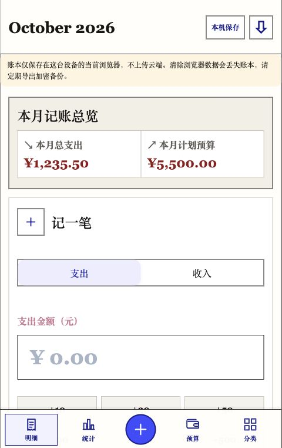
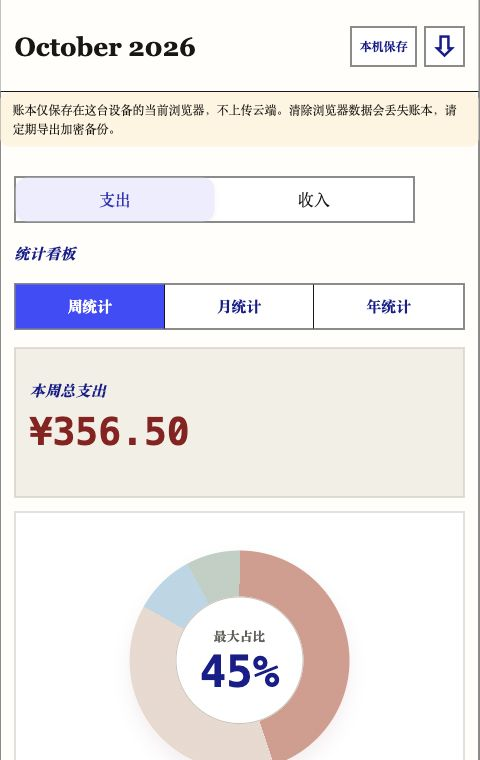
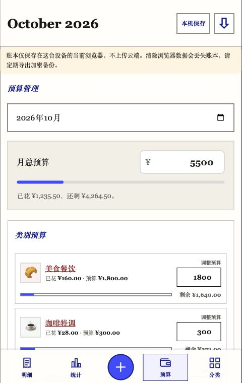

# 已老实记账 · Beta

一个无需注册、账本保存在浏览器本地的轻量记账工具。支持收入与支出、分类统计、月度预算，以及密码加密备份。

**[在线使用 →](https://kimberlyxu75.github.io/yi-laoshi-jizhang/)**

当前为公开测试版。建议先用少量测试账单熟悉操作并验证备份恢复，再用于长期记账。

## 功能预览

以下为实际界面截图，金额与账单均为虚构演示数据。

| 记一笔 | 收支分布 | 预算管理 |
| :---: | :---: | :---: |
|  |  |  |
| 收入、支出分别记录 | 周／月／年独立统计 | 手动总预算与类别自动汇总 |

## 功能

- 收入／支出分别记录金额、日期、分类和备注；支持快捷金额。
- 周、月、年收支独立统计；周明细、分类分布、月历和年度趋势。
- 可手动填写月总预算；修改类别预算后，总预算更新为全部支出类别预算之和。
- 收支分类分组收纳，可新增、编辑及删除未使用的类别。
- 最近 7 天明细；可删除账单，并在当前会话撤销最近一次删除。
- 密码加密导出、恢复和本次会话内撤销恢复；兼容旧版 JSON 备份。
- PWA 离线页面缓存；可在支持的浏览器添加到主屏幕。

## 先了解数据如何保存

**无需账号，不会自动上传账本，也没有跨设备自动同步。** 数据存放在当前网站来源、浏览器配置文件的本地存储中。同一浏览器配置文件下共享设备的人可能访问同一账本。

- 清理网站数据、切换浏览器、卸载或更换设备可能导致无法访问原账本。
- 本地账本以明文保存；加密保护的是导出的备份文件。
- 备份密码至少 12 个字符。请在安全位置保存密码和备份，密码丢失无法恢复。
- 定期导出备份；换设备或清理缓存前先备份。恢复前会要求先备份原账本。
- 保存失败时会提示并保留表单内容；看到失败提示后，不要把本次修改当作已经保存。
- 更换网站域名或路径不会自动迁移账本。先从旧地址导出，再在新地址恢复。
- 网站托管服务可能记录访问日志；“账单不上传”不表示托管服务不处理任何访问数据。

## 本地运行

需要 Python 3。无需安装前端依赖即可运行网页：

```sh
python3 -m http.server 4173 --bind 127.0.0.1
```

打开 <http://127.0.0.1:4173/>。请使用 localhost 或 HTTPS，以支持安全加密及 Service Worker。直接双击 HTML 不适合作为完整验收方式。

## 开发与检查

需要 Node.js 22 或更新版本，以及 Python 3。

```sh
npm ci
npm run build:minitool
npm test
npm run package
```

`dist/` 为网页部署产物，`minitool-dist/` 为小工具产物。小工具构建包含兼容性及包内容检查。测试包含数据验证、加密备份、保存失败回退及删除撤销；不能代替真机与离线验收。

## 发布网页

参见 [DEPLOY.md](DEPLOY.md)。部署 `dist/`，不要把整个开发目录作为发布内容。

iPhone：使用 Safari 打开 HTTPS 地址，通过分享菜单添加到主屏幕。

Android：使用支持 PWA 的浏览器，通过浏览器菜单安装或添加到主屏幕。具体入口和能力取决于浏览器版本。

## 当前限制

- 无登录与云同步；需主动备份。
- 最近明细只展示 7 天；历史账单可通过月历查看，尚无全文搜索或账单编辑。
- 删除撤销仅保留当前会话最近一次删除，刷新后失效。
- 未完成 iPhone／Android 真机安装、离线写入及跨版本升级的完整验收。
- 币种为人民币，不支持多币种或资产账户。

## 反馈

发现问题可在仓库 Issues 中描述复现步骤、浏览器和系统版本，以及预期和实际结果。截图请隐藏真实账单；不要上传备份文件、备份密码或其他个人信息。

## 许可

项目代码采用 [MIT License](LICENSE)。依赖的第三方代码遵循各自许可证。
